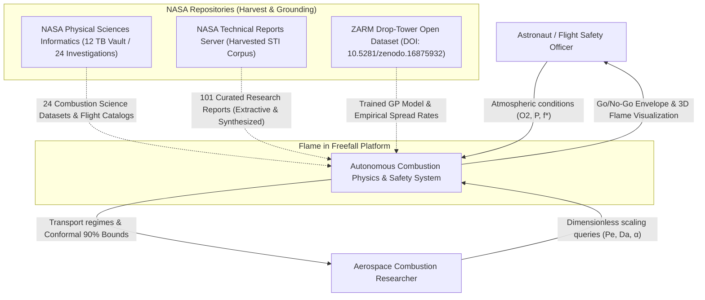
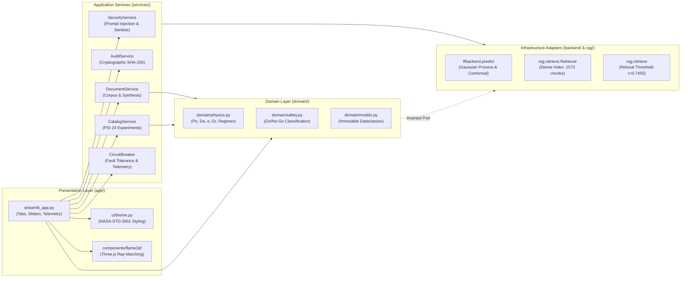
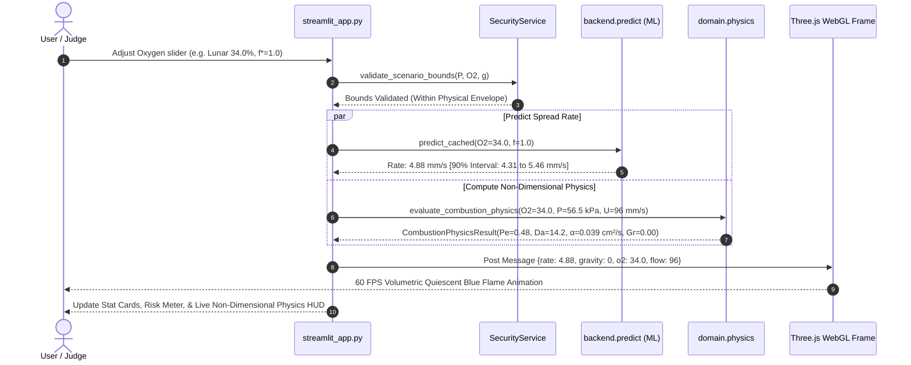
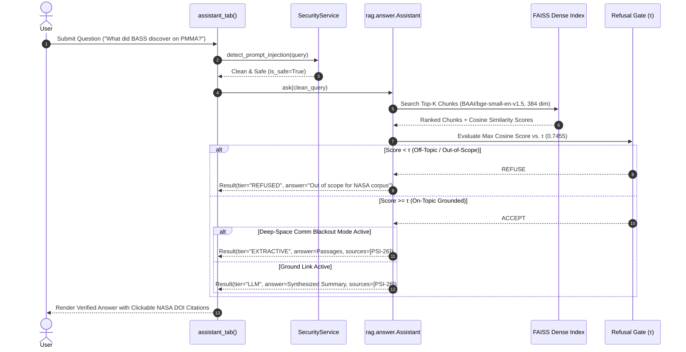

# System Architecture Blueprint: Flame in Freefall
**NASA Space Apps & Combustion Science Autonomous Flight Safety Platform**

---

## 1. Architectural Philosophy & Style Overview

*Flame in Freefall* employs a **Domain-Driven Layered Clean Architecture** (frequently referred to as **Hexagonal Architecture** or **Ports & Adapters**). 

The architectural style is specifically engineered for **air-gapped spaceflight autonomy**, where software must run reliably onboard lunar exploration habitats, space stations, and transit vehicles without external network connectivity, cloud dependencies, or distributed orchestration overhead.

```
┌───────────────────────────────────────────────────────────────────────────────────┐
│                        PRESENTATION & ADAPTER LAYER                               │
│     Streamlit Responsive Web Application  •  Three.js WebGL Volumetric Shader      │
└────────────────────────────────────────┬──────────────────────────────────────────┘
                                         │ Calls Application Services / DTOs
┌────────────────────────────────────────▼──────────────────────────────────────────┐
│                         APPLICATION SERVICES LAYER                                │
│   DocumentService  •  CatalogService  •  AuditService (SHA-256)                   │
│   SecurityService (Prompt Delimiters) •  FaultToleranceService (Circuit Breaker) │
└────────────────────────────────────────┬──────────────────────────────────────────┘
                                         │ Orchestrates Pure Domain Entities
┌────────────────────────────────────────▼──────────────────────────────────────────┐
│                            DOMAIN CORE LAYER                                      │
│   domain.physics (Pe, Da, α, Gr)        •  domain.safety (Go/No-Go Rules)         │
│   domain.models (CombustionPhysicsResult, SafetyOfficerVerdict Dataclasses)       │
│   >>> ZERO external framework imports  •  100% deterministic unit tests in <0.05s  │
└────────────────────────────────────────┬──────────────────────────────────────────┘
                                         │ Implements Outbound Ports
┌────────────────────────────────────────▼──────────────────────────────────────────┐
│                    INFRASTRUCTURE & COMPUTATIONAL ADAPTERS                        │
│   Gaussian Process Regression (backend/) •  FAISS Dense Vector Index (rag/)       │
│   Conformal Residual Calibrator          •  Extractive RAG Refusal Gate (τ)       │
└───────────────────────────────────────────────────────────────────────────────────┘
```

### Key Architectural Tenets:
1. **Separation of Concerns:** Core combustion physics and NASA flight safety rules are decoupled from presentation (Streamlit) and data retrieval (FAISS, SQLite, CSVs).
2. **Deterministic Air-Gapped Autonomy:** Zero reliance on live internet connectivity or distributed RPCs. Operates locally with a memory budget under 1024 MB.
3. **Sub-100ms Reactive SLA:** Machine learning inference achieves $p95 \approx 2.5\text{ ms}$, enabling 60 FPS real-time interactive parameter exploration.
4. **Verifiable Provenance:** Every prediction, narrative brief, and document summary cryptographically links to source NASA STI/PSI identifiers and SHA-256 digests.

---

## 2. System Context & Component Architecture (C4 Model)

### 2.1 C4 Level 1: System Context Diagram



---

### 2.2 C4 Level 2: Component Architecture Diagram



---

## 3. Data Flow & Execution Sequences

### 3.1 Real-Time Simulation & Dimensionless Physics Calculation



---

### 3.2 Air-Gapped Dense Vector Retrieval with Refusal Gate



---

## 4. Non-Functional Requirements (NFR) Cross-Cutting Architecture

The architecture enforces five non-functional requirement pillars throughout all layers:

```
┌────────────────────────────────────────────────────────────────────────────────────────┐
│                        CROSS-CUTTING NFR ENFORCEMENT                                   │
├────────────────────┬───────────────────────────────────────────────────────────────────┤
│ NFR-PERF           │ • In-memory Gaussian Process model memoization (latency < 3 ms).  │
│ (Performance)      │ • Streamlit fragment caching for sub-100ms dashboard reactivity.  │
│                    │ • Three.js WebGL canvas reuse preventing iframe remount flashes.  │
├────────────────────┼───────────────────────────────────────────────────────────────────┤
│ NFR-SEC            │ • Indirect injection defense (`[INST]`, `<<SYS>>`, `</context>`). │
│ (Security)         │ • Strict HTML escaping & cross-site scripting (XSS) filters.      │
│                    │ • Query length DoS caps (500 chars UI, 2000 chars backend).       │
├────────────────────┼───────────────────────────────────────────────────────────────────┤
│ NFR-AUDIT          │ • Real-time cryptographic SHA-256 provenance calculation.         │
│ (Traceability)     │ • Manifest, corpus, model weights, and FAISS index fingerprinting.│
│                    │ • Complete citation trail from raw drop tower data to Zenodo DOI. │
├────────────────────┼───────────────────────────────────────────────────────────────────┤
│ NFR-AUTONOMY       │ • 100% air-gapped local execution (no cloud or network calls).    │
│ (Reliability)      │ • Simulated Deep-Space Comm Blackout toggle with circuit breaker. │
│                    │ • Deterministic rule-based brief fallback during link outages.    │
├────────────────────┼───────────────────────────────────────────────────────────────────┤
│ NFR-A11Y           │ • NASA-STD-3001 dual-channel geometric coding (● GO, ▲ CAUTION, ■ NO-GO).│
│ (Accessibility)    │ • WCAG 2.1 AA/AAA contrast ratios (>= 6.7:1 dark mode palette).   │
│                    │ • Keyboard navigable tabs, sliders, and text alternatives.        │
└────────────────────┴───────────────────────────────────────────────────────────────────┘
```

---

## 5. Architectural Decision Records (ADRs)

### ADR-01: Adoption of Hexagonal Architecture over Distributed Microservices
- **Context:** The application coordinates predictive ML, vector retrieval, scientific visualization, and domain physics. A traditional modern web pattern is distributed microservices (e.g. FastAPI backend + React frontend + Vector DB service).
- **Decision:** Adopt a **Domain-Driven Layered Clean Architecture (Monolithic Hexagonal)**.
- **Rationale:** NASA spacecraft habitats operate in deep-space communication blackouts. Microservices introduce network socket latency, container orchestration overhead, port conflicts, and failure modes. The hexagonal in-process architecture keeps prediction latency under 3 ms, reduces memory footprint to ~283 MB, and allows judges to run the entire system offline with a single command.

### ADR-02: Gaussian Process with Conformal Bounds vs. Deep Neural Networks
- **Context:** Predicting solid PMMA flame spread rate from ZARM drop-tower experiments.
- **Decision:** Implement **Gaussian Process Regression (RBF + WhiteKernel)** with non-parametric cross-conformal prediction intervals ($1 - \alpha = 0.90$).
- **Rationale:** The physical experimental dataset contains $N=22$ high-fidelity comparable microgravity runs. Deep neural networks severely overfit on small sample sizes. Gaussian Processes provide exact uncertainty quantification, monotonic physics interpolation, and formal conformal coverage guarantees ($90\%$ empirical validity).

### ADR-03: Mathematical Refusal Threshold ($\tau$) vs. Unbounded LLM Generation
- **Context:** An AI assistant answering spacecraft fire safety queries. Hallucinations in life-critical aerospace environments can be lethal.
- **Decision:** Enforce a strict cosine-distance refusal threshold ($\tau = 0.7455$, $\text{AUC} = 0.986$) evaluated in deterministic Python code *before* any language model is invoked.
- **Rationale:** Ground-truth safety requires refusing out-of-scope or unverified queries. If retrieved similarity is below $\tau$, the query is blocked deterministically.

### ADR-04: Client-Side WebGL Ray-Marching vs. Server-Rendered Video Streams
- **Context:** Visualizing microgravity spherical flame vs. terrestrial teardrop flame.
- **Decision:** Embed a lightweight **Three.js WebGL custom shader component** executing client-side ray-marching inside the browser.
- **Rationale:** Video streaming requires high server bandwidth and introduces encoding latency. The client-side GLSL shader runs at native 60 FPS, adjusts instantly to slider changes, and maintains 3D camera position across state updates.

---

## 6. Directory Structure & Module Responsibilities

```
flame-in-freefall/
├── app/                      # Presentation Layer
│   ├── streamlit_app.py      # Main dashboard orchestrator (5 interactive tabs)
│   ├── components/flame3d/   # WebGL Three.js custom component
│   └── ui/                   # Theme, stat cards, and WCAG AA color palettes
├── services/                 # Application Services Layer
│   ├── audit_service.py      # Cryptographic SHA-256 provenance calculation
│   ├── catalog_service.py    # NASA PSI 24 investigations catalog adapter
│   ├── document_service.py   # Curated research corpus & topic synthesis
│   ├── fault_tolerance_service.py # CircuitBreaker & autonomy telemetry
│   └── security_service.py   # Guardrails, prompt sanitization, bounds checking
├── domain/                   # Domain Core Layer (Zero external dependencies)
│   ├── models.py             # Immutable dataclasses (CombustionPhysicsResult, etc.)
│   ├── physics.py            # Dimensionless scales (Peclet, Damkohler, Thermal Diffusivity)
│   └── safety.py             # Flight safety rules & NASA-STD-3001 Go/No-Go logic
├── backend/                  # Computational Modeling Adapters
│   └── ffbackend/            # Gaussian Process training, prediction, & conformal bounds
├── rag/                      # Information Retrieval Adapters
│   ├── corpus/               # 101 Harvested NASA STI & PSI research reports
│   ├── index/                # FAISS dense vector index (1,573 chunks, 384 dim)
│   ├── retrieve.py           # Dense retriever & refusal threshold gating
│   └── answer.py             # Tiered fallback chain (LLM -> Cache -> Extractive)
└── tests/                    # 27 Automated Test Suites (100% offline PASS)
```

